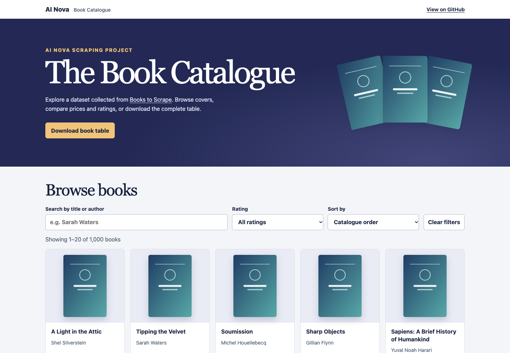

# AI Nova Book Scraping Tool

A Python scraper collects 1,000 books from [Books to Scrape](https://books.toscrape.com/).
The web catalogue lets you browse covers, search by title or author, filter by star rating, and sort by title, price, or rating.

- [Open the book catalogue on GitHub Pages](https://lumimaki.github.io/AI-NOVA-Book-Scraping-Tool/)
- [View all 1,000 books as a table on GitHub](docs/books.csv)
- [View the Python scraper](scraper.py)

The CSV contains each book's title, author when available, price in GBP, rating out of five, stock availability, and original product URL.
The site reads the matching [JSON export](docs/books.json), which also includes cover image URLs.
Books to Scrape is a practice catalogue, so the prices and stock labels are demo data.

## Purpose and user interaction

This project demonstrates a complete collection pipeline: scrape a multi-page practice shop, clean and enrich the records, store the base records in a database, and present the result through a searchable browser interface. A user can search by title or available author, filter by rating, sort by title, price, or rating, move through 50 pages, follow a record to its original product page, or download the CSV table.

## Data collection

`scraper.py` requests the 50 catalogue pages from Books to Scrape and parses each book card with Beautiful Soup. It collects the title, price, star rating, stock label, product URL, and cover URL. The scraper pauses briefly between page requests, raises an error when a page contains no books, and checks for duplicate product URLs.

Books to Scrape does not provide author fields. The checked-in `data/book_authors.csv` contains reviewed matches for 723 records and records a source URL and match basis for each credit. Unmatched books remain available and display **Author unavailable**. See [Author data](#author-data) for sources and limitations.

## Data persistence

The scraper always writes reproducible CSV and JSON exports to `docs/`. With `--upload`, it also upserts the five base scraped fields into a Supabase PostgreSQL `books` table, using `product_url` as the conflict key. The required table definition is in [`database/schema.sql`](database/schema.sql). Credentials stay in a local `.env` file that Git ignores; `.env.example` contains placeholders only.

The public catalogue intentionally reads the checked-in JSON export, so visitors do not need database credentials and no private key is sent to the browser. The database demonstrates persistent structured storage, while the static export makes the demonstration inexpensive and reproducible.

## Demonstration



The screenshot shows the real published interface and dataset text. External book-cover artwork was replaced with original neutral placeholders in the screenshot only to avoid redistributing third-party cover images. The live catalogue continues to load the cover URLs supplied by Books to Scrape.

Open the [live catalogue](https://lumimaki.github.io/AI-NOVA-Book-Scraping-Tool/), search for `Sarah Waters`, change the rating or sort order, clear the filters, move to the next page, and use **Download book table** to inspect the complete dataset. The interface reports how many records match the current filters. No account or personal information is required.

## Run locally

The published data and catalogue require only Python 3's built-in web server. From the repository root, start a static server and leave it running:

```sh
python3 -m http.server 8000 --bind 127.0.0.1 --directory docs
```

Open [the local catalogue](http://127.0.0.1:8000/).

No environment file is required to browse the checked-in dataset. Regenerating data requires Python 3, network access, and the packages in `requirements.txt`. Supabase is optional unless you want to repeat the database upload.

## Development workflow

1. **Initial catalogue.** Scraped 50 listing pages, exported 1,000 books, and published a title-searchable catalogue and CSV on GitHub.
2. **Author search.** Matched catalogue records against bibliographic sources, added an author column to both exports, and updated the search and book cards. Try **Sarah Waters** for *Tipping the Velvet*, **Silverstein** for *A Light in the Attic*, or **Marie Kondo** for books credited to Marie Kondō.

See the [commit history](https://github.com/Lumimaki/AI-NOVA-Book-Scraping-Tool/commits/main/) and [GitHub Pages workflow runs](https://github.com/Lumimaki/AI-NOVA-Book-Scraping-Tool/actions) for the published changes.

### Author data

Author credits are available for **723 of 1,000 books**. Books to Scrape does not provide a dedicated author field. The [author matches file](data/book_authors.csv) records the source and match method for each credit. Matches use distinctive titles, agreement with [catalogue descriptions](https://github.com/Lucas382/ScrapyTemplate/blob/master/bookdata.csv), or a direct bibliographic reference. Titles with uncertain matches still appear in title searches and show **Author unavailable**.

The main references were [Best Books Ever by Lorena Casanova Lozano and Sergio Costa Planells (CC BY-NC 4.0)](https://doi.org/10.5281/zenodo.4265096), [Goodbooks-10k](https://github.com/zygmuntz/goodbooks-10k), and [Open Library](https://openlibrary.org/).

## Regenerate the book exports

```sh
python3 -m venv .venv
source .venv/bin/activate
python -m pip install -r requirements.txt
python scraper.py
```

The scraper joins the checked-in [author matches](data/book_authors.csv) by product URL before writing `docs/books.csv` and `docs/books.json`.

To repeat the database upload:

1. Create a Supabase project and run [`database/schema.sql`](database/schema.sql) in its SQL editor.
2. Copy `.env.example` to `.env` and replace the placeholders locally. Use a server-side key suitable for the upload script; never commit or expose it in browser code.
3. Run `python scraper.py --upload`.

The upload uses batches of 100 and upserts on `product_url`, so rerunning it updates matching records instead of creating duplicates. The author enrichment is stored in the exports but is not uploaded because the original database pipeline predates that enrichment; this is a documented limitation rather than an implied database field.

## GitHub Pages

The site source lives in `docs/`. In the repository's **Settings → Pages**, set **Source** to **Deploy from a branch** and select **main** and **/docs**.

## Learning and challenges

- **Pagination and validation.** Collecting all 1,000 records required iterating over 50 pages, resolving relative links, translating CSS rating classes to numbers, and checking for empty pages and duplicate product URLs.
- **Data enrichment.** The source catalogue omitted authors. I kept the original scrape reproducible and used a separate evidence file for reviewed author matches, allowing uncertain records to remain explicitly unavailable instead of inventing values.
- **Database and publication boundaries.** The Python upload uses private environment variables on the developer machine, while the public interface reads a generated JSON file. This separates database credentials from browser code and keeps the live demonstration static.
- **Interface design.** The browser catalogue turns the collected records into a usable result with search, filters, sorting, pagination, source links, and a downloadable table.

## Limitations and assistance

- Prices, availability, and ratings are training data from Books to Scrape and can become stale if the source changes. The scraper has no retry policy beyond request errors and depends on the source site's current HTML structure.
- Author credits are incomplete and come from multiple bibliographic sources with different licensing terms. The evidence file records the source and method; unmatched or uncertain records remain blank.
- The public interface reads the JSON export rather than querying Supabase live. The Supabase table stores the five base scraped fields and does not include the later author or cover enrichment.
- Cover images load from Books to Scrape, so they require network access and remain subject to the source site's availability. The repository does not redistribute the image files.
- Codex and ChatGPT assisted with the interface, author-search improvements, publication audits, documentation, and security review. Generated suggestions were reviewed against the project files; limitations and unverified checks are recorded in [`AUDIT.md`](AUDIT.md).
- No source-code license has been added. External datasets and sites retain their own terms.
